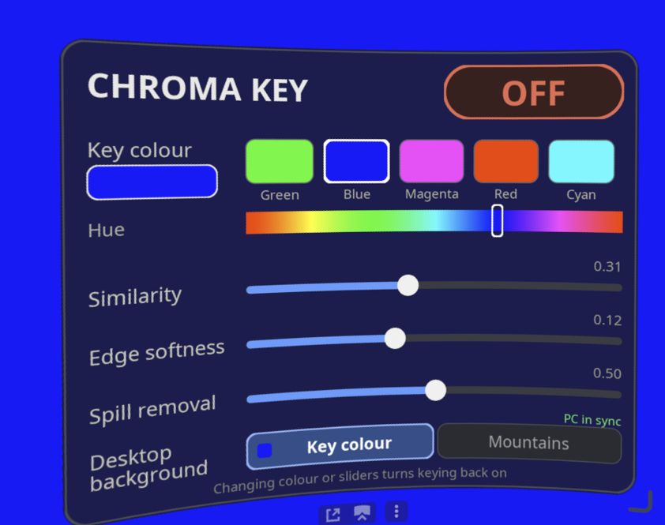

# Steam Frame passthrough: explicit-mask development fork

This fork is adding **real per-eye opacity masks** for PC streaming. Scene colors
will remain independent of transparency, and the passthrough camera remains on
the headset.

The first development checkpoint contains the bounded mask transport, an
explicit-mask shader generator, actual Vulkan rendering tests, and a Frame
diagnostics collector. **The Steam Link frame/texture adapter is not implemented
yet; this is not an installable genuine-mask passthrough feature.** The legacy
layer refuses mask shaders until that adapter can bind them correctly.

Development branch: [`dev`](https://github.com/McFredward/steam-frame-chroma-key/tree/dev).
See [mask implementation and tests](docs/MASK-TRANSPORT.md) and
[remaining Steam Link integration](docs/MASK-BRIDGE-INVESTIGATION.md).

The [read-only live inspection](docs/LIVE-BRIDGE-INSPECTION.md) reads bounded
existing Frame diagnostics without installing anything or starting another VR
client. The [PC source collector](docs/PC-MASK-SOURCE.md) inspects the installed
Steam Link driver separately. Neither tool enables masks or changes SteamVR.

The supplied PC driver now has a concrete
[encoder/transmitter dataflow](docs/PC-DRIVER-20261011.md), and the native shader
inspection identifies a [conditional full-eye UV route](docs/FRAME-UV-BINDING-20261011.md).
A separate [bounded passive pipeline diagnostic](docs/PASSIVE-PIPELINE-TRACE.md)
has verified 39 complete recorded/submitted stage pairings on the inspected Frame
build. The later [compact-journal native capture](docs/FRAME-COMPACT-JOURNAL-RUN-20261011.md)
retains 703,494 resource observations without loss and 32 complete CPU resource
snapshots. Neither capture establishes GPU-consumed eye values or source-video
identity. The next adapters must join [native receiver selection and resource import](docs/FRAME-NEXT-ADAPTER.md)
with [actual Windows composition and transmitter keys](docs/PC-NEXT-ADAPTER.md).
An [opt-in receiver observer](docs/RECEIVER-OBSERVER-IMPLEMENTATION.md) is now built
and tested offline to inspect bounded, protected selection metadata. Its first
[native startup attempt](docs/FRAME-RECEIVER-LAUNCH-20261012.md) established that
the receiver starts under the Steam client service; the original SteamVR-only
activation could not reach it. The [approved Steam-client attempt](docs/FRAME-RECEIVER-STEAM-RUN-20261012.md)
loaded the observer in the receiver, but a Btrfs file-identity guard refused
arming. The [later successful receiver capture](docs/FRAME-RECEIVER-CAPTURE-20261012.md)
now provides 32 valid protected selections without loss. Exact PC source-frame,
compositor resource/eye and GPU association remain incomplete.
After a [SteamOS update](docs/FRAME-RECEIVER-UPDATE-20261012.md), the receiver
observer was revalidated against the current native binary before any new
deployment; unknown or stale builds remain refused.
The [compositor import diagnostic preparation](docs/COMPOSITOR-IMPORT-PREPARATION.md)
now has bounded offline state, exact entry-layout checks and a read-only kernel
socket-pair helper. Its production/native-lifetime integration is still pending;
these components do not enable streamed passthrough.
An [authentic client connection capture](docs/CLIENT-CONNECT-CAPTURE-20261012.md)
now confirms normal headset startup and a successful native receiver connection
call. Continuous descriptor lifetime and exact resource/video association remain
separate, incomplete steps; the temporary diagnostic was fully removed afterward.
The [register-only resource census](docs/CLIENT-RESOURCE-CENSUS.md) has now
[captured all six native import/reference boundaries](docs/CLIENT-RESOURCE-CAPTURE-20261012.md).
It establishes that the actual resource thread needs its own safe stack
registration. The bounded kernel peer lookup refused its FD scan limit;
connection lifetime and resource/video association remain incomplete. The
diagnostic was fully removed and original Frame state verified afterward.
An [explicit cold decoder-thread adapter](docs/CLIENT-RESOURCE-THREAD-PREPARATION.md)
has now [prepared the real decoder thread](docs/CLIENT-RESOURCE-THREAD-CAPTURE-20261012.md):
all six captured resource boundaries had current-thread stack ownership. The
corrected external lookup also observed the current receiver/compositor kernel
peer pair. A later ownership check safely ended acquisition; neither this
finite observation nor the later peer snapshot establishes continuous lifetime,
resource/video or GPU association. The temporary diagnostic was fully removed.
These diagnostics change no rendered pixels and do not enable genuine-mask
passthrough.
The [bounded raw import adapter](docs/CLIENT-RESOURCE-RAW-PREPARATION.md)
is built and reviewed offline, with actual final ARM read/write/cancellation
checks and the complete 56-check local host gate. Its
[actual Frame capture](docs/CLIENT-RESOURCE-RAW-CAPTURE-20261013.md) now records
one complete matching request/reply and following receiver reference, using
393 additional private metadata bytes. The temporary diagnostic was fully
removed. Compositor resource, source video/eye/UV and GPU association remain
unproven; streamed genuine-mask passthrough is not enabled.
The next [raw compositor components](docs/COMPOSITOR-RESOURCE-RAW-PREPARATION.md)
now reuse the native decoder and public Vulkan result types with bounded
copy admission. Their software checks pass; production bootstrap, the owning
resource-journal bridge and actual compositor capture are still pending.

The original upstream chroma-key implementation and instructions below remain
available as a separate path. They do not enable the new explicit-mask path.

---

## Original chroma-key passthrough

Mixed reality on the Steam Frame over Valve's normal PC streaming, with no ALVR and no Virtual Desktop.

Paint your SteamVR game's background a solid colour (for example pure green) and the Steam Frame
replaces that colour with its own passthrough camera. Valve's native streaming (vrlink, hardware decode) is unchanged.
No second video stream is added, the camera image never leaves the headset, and the cost is about 0.3 ms of GPU time
with no extra frame of latency.



What you get:

- **In-headset panel** in the SteamVR dashboard: keying ON/OFF, key colour presets and hue bar, Similarity, Edge
  softness and Spill sliders.
- **Desktop background switch** (*Key colour* / *Mountains*): with no game running, it makes the PC SteamVR home
  backdrop the key colour, so you see your room around the SteamVR desktop view. Switch back to the default
  mountains with one click.
- **PC control panel** (optional): eyedropper to sample the background colour straight off your monitor, a colour
  picker and the same sliders.
- Everything is user-scope. Nothing under `/usr` or `/opt` is modified, and `uninstall.sh` rolls it all back.

> **Warning**
> This is an unofficial hack that hooks SteamVR's compositor through internal, undocumented details. It was built and
> tested on **SteamOS holo 0.4.5 (build 20261007)** with the SteamVR version shipped on the headset at that time.
> A SteamVR update can break it. When that happens the shader generator refuses to run rather than produce a broken
> shader, and the layer falls back to the stock shader. See [Fragility](#fragility). Use at your own risk.

---

## Requirements

- A Steam Frame streaming from a Windows PC with SteamVR.
- **Developer Mode** on the headset, for SSH access.
- On the PC: an SSH client (built into Windows 10/11) and, for the optional PC tools, **Python 3** from
  [python.org](https://www.python.org/) (includes tkinter).

The headset already ships with the build tools this needs: `g++`, `glslc`, `spirv-tools`, `python3`, `freetype2`
and `git`.

## Install

### 1. Enable Developer Mode and SSH on the headset

1. On the Frame: **Steam Settings → System → Enable Developer Mode**.
2. In the left menu, scroll down to the **Developer** section, then scroll toward the bottom of that page and click
   **Set User Password**.
3. Find the headset's IP address in its Wi-Fi settings.

The username is `steamos`. Check that it works from the PC:

```powershell
ssh steamos@<headset-ip>
```

If SSH stops working after a reboot, check the Frame's current IP first. With
the default device name and working local hostname discovery, you can also use
`ssh steamos@frame.local` so an IP change does not break the connection.
Keep Developer Mode enabled. In the Frame's desktop terminal, this command
starts SSH immediately and enables it for future boots:

```bash
sudo systemctl enable --now sshd.service
```

After a reboot, `systemctl is-enabled sshd.service` should report `enabled` and
`systemctl is-active sshd.service` should report `active`. These are the native
service controls; no separate SSH startup script is required.
See [Valve's developer setup](https://partner.steamgames.com/doc/steamhardware/steamframe/setup)
and [systemd's service controls](https://github.com/systemd/systemd/blob/main/man/systemctl.xml).

### 2. Set up a `frame` SSH alias with a key (on the PC)

The PC tools reach the headset through an SSH alias named `frame`, using key login so they never prompt for a
password. In PowerShell:

```powershell
ssh-keygen -t ed25519 -f $HOME\.ssh\id_ed25519_frame -N '""'
type $HOME\.ssh\id_ed25519_frame.pub | ssh steamos@<headset-ip> "mkdir -p ~/.ssh && cat >> ~/.ssh/authorized_keys && chmod 600 ~/.ssh/authorized_keys"
```

Add this to `%USERPROFILE%\.ssh\config` (create the file if it doesn't exist):

```
Host frame
    HostName <headset-ip>
    User steamos
    IdentityFile ~/.ssh/id_ed25519_frame
    IdentitiesOnly yes
    ServerAliveInterval 15
```

Now `ssh frame` should log in with no password prompt. If you only plan to use the in-headset panel, you can skip
this step and SSH in however you like.

### 3. Build and install on the headset

SSH into the headset (`ssh frame`) and run the following. The repo **must be cloned to `~/mr-chroma`**, because the
panel and PC tools call scripts at that path.

```bash
git clone https://github.com/spyjacob/steam-frame-chroma-key.git ~/mr-chroma
cd ~/mr-chroma

./build.sh && ./install.sh                                     # build the Vulkan layer + helper, install user-scope
touch ~/.config/mrchroma/enable-compositor                     # opt the compositor in to the layer
~/.local/share/mrchroma/mrctl set-bool camera forceSceneAlphaBlending 1
systemctl --user restart steamvr                               # SteamVR restarts and loads the layer (~15 s)
```

Wait for SteamVR to come back (put the headset on so it wakes up), reconnect the PC stream if it dropped, then:

```bash
./mrkey.sh chroma 0 1 0 0.32 0.12 0.5      # key pure green: R G B similarity softness spill
toggle/install_toggle.sh                   # in-headset dashboard panel (recommended)
```

Your settings persist across SteamVR restarts and reboots.

### 4. PC tools (optional)

From a copy of this repo on the PC:

- **Desktop background sync.** This makes the panel's *Desktop background* switch work. It runs hidden at login:

  ```powershell
  python pc\mrchroma_pcsync.pyw --install      # adds a Startup-folder shortcut and starts it now
  ```

  It uses the `frame` alias by default. To use a different host, set the `MRCHROMA_HOST` environment variable.
- **PC control panel** with the eyedropper: double-click `pc\mrchroma_panel.pyw`.

## Using it

1. In your game, make the background a solid colour, such as pure green `(0, 255, 0)`, using an
   unlit skybox, scene background or large plane.
2. Stream to the Frame as usual through SteamVR (normal **OpenVR** mode, not Virtual Desktop).
3. Open the SteamVR dashboard and click the **Chroma Key** icon in the bottom bar.
   - **ON/OFF** toggles keying.
   - Pick a **key colour** preset or drag the **hue** bar to match your background.
   - **Similarity** sets how far from the key colour still counts as background. Raise it if patches of
     background remain, and lower it if parts of your subject disappear.
   - **Edge softness** sets the width of the fade at edges.
   - **Spill removal** removes the coloured fringe the key colour leaves on edges.
   - **Desktop background**: *Key colour* shows passthrough around the SteamVR desktop view when no game is running,
     and *Mountains* restores the normal SteamVR home. This needs the PC sync helper. The panel shows *PC in sync*,
     *waiting for PC* or *PC helper not responding*.

   Colour and slider changes apply when you release the trigger.

From a shell on the headset you can do the same things:

```bash
~/mr-chroma/mrtoggle.sh on|off|toggle|status       # keying on/off, keeps the last colour/settings
~/mr-chroma/mrkey.sh chroma R G B sim soft spill   # set colour + params (0..1 values)
~/mr-chroma/mrkey.sh rect                          # debug: key a fixed rectangle in the middle of each eye
~/mr-chroma/mrtoggle.sh bg on|off|toggle|status    # PC desktop background: key colour / mountains
```

## Uninstall

On the headset:

```bash
cd ~/mr-chroma
./uninstall.sh            # turns the blending setting back off, removes the layer + panel
systemctl --user restart steamvr
```

`./uninstall.sh --purge` also deletes the config and the settings backup. A copy of your original
`steamvr.vrsettings` is kept in `~/.local/share/mrchroma/backup/`.

On the PC: `python pc\mrchroma_pcsync.pyw --uninstall` removes the helper and restores the default SteamVR background.

**Emergency off switch** (if SteamVR misbehaves): delete `~/.local/share/vulkan/implicit_layer.d/mrchroma.json` or
`~/.config/mrchroma/enable-compositor`, then restart SteamVR. There is also a crash guard: if the compositor starts 3
times within 120 s with the layer loaded, the layer stops loading and writes
`~/.local/share/mrchroma/compositor-guard-tripped`. Delete that file to re-arm it.

---

## How it works

1. `vrlink` (the streaming client on the headset) does **no rendering**. It hardware-decodes the stream into NV12
   dma-buf images (1152×4608, packed/foveated) and passes them to `vrcompositor`. vrlink never has an RGBA frame, so
   the key can't be done there.
2. `vrcompositor` converts YCbCr→RGB and reprojects/distorts the stream in
   **`distort_ps_achromatic_se2.spv`**, writing `vec4(rgb, 1.0)` into each eye buffer.
3. When the hidden setting `camera/forceSceneAlphaBlending` is true, the compositor draws the passthrough camera
   every frame, blended `src = ONE_MINUS_DST_ALPHA, dst = ONE`. The camera shows through wherever the scene's alpha
   is below 1.
4. This project adds a user-scope **Vulkan layer**. Inside vrcompositor only, it swaps that one shader module in
   memory for a patched SPIR-V. The patched shader computes alpha from a CbCr-distance chroma key, with smoothstep
   edge softness and spill suppression, and writes premultiplied `(rgb·a, a)`.

The patched shader is generated **on your headset** from your SteamVR install's own shader, so no Valve files are
redistributed here. Dashboards and overlays are drawn afterwards with normal alpha, so they stay opaque. Stereo,
tracking and reprojection are the compositor's own.

### Components

| Path | What |
|---|---|
| `layer/mrchroma_layer.cpp`, `layer/compositor_hooks.inc` | The Vulkan layer. It loads only into `vrcompositor` (opt-in flag file) and `vrlink` (log only). Every other process gets "Skipping layer" from the loader. |
| `tools/gen_key_spv.py` | Patches the compositor shader disassembly into a rect-test or chroma-key variant, then assembles and validates it. |
| `mrkey.sh` | `off` / `rect` / `chroma R G B threshold softness spill`. Regenerates the shader and hot-reloads compositor shaders (`vrcmd --reload-shaders`). |
| `mrtoggle.sh` | `on` / `off` / `toggle` / `status`, plus `bg ...`. Re-enables the last generated shader without regenerating it. |
| `tools/mrctl.cpp` | OpenVR helper: get/set settings, measure frame timing (`mrctl timing 8`). |
| `toggle/` | The SteamVR dashboard overlay. It is software-rendered with FreeType via `SetOverlayRaw` and autolaunched through a user app manifest (`mrchroma.toggle`). `mrtoggle_overlay --render out.ppm` renders the layout without SteamVR. |
| `pc/mrchroma_pcsync.pyw`, `pc/vrsettings_win.py` | PC helper that keeps the PC SteamVR home background in step with the headset. It writes through SteamVR's public settings API (`IVRSettings` in `openvr_api.dll`), applies changes live and idles while SteamVR is closed. Log: `%LOCALAPPDATA%\mrchroma\pcsync.log`. |
| `pc/mrchroma_panel.pyw` | PC control panel (tkinter): eyedropper, colour picker, sliders, all over `ssh frame`. |
| `install.sh` / `uninstall.sh` | User-scope install and full rollback. |

### Why the desktop-background helper exists

When you stream from the PC with no game running, the **PC's** SteamVR draws its own background (sky, mountains,
floor, ground circles, base stations) into the video. The headset only receives finished pixels, so there is nothing
to key. The helper sets the PC's `steamvr/background` to the key colour and hides `showFloor`, `showGridCircles` and
`drawTrackingReferences`. For *Mountains* it removes those keys so the defaults come back. Games aren't affected
because they draw their own background.

### Measured (PC streaming, 90 Hz)

| Mode | Refresh | Compositor GPU p50 / p95 | Dropped / 8 s |
|---|---|---|---|
| Off | 90.0 Hz | 2.88–2.94 / 3.31–3.33 ms | 0–1 |
| Chroma | 90.0 Hz | 3.17–3.33 / 3.33–3.48 ms | 0 |

## Fragility

The patcher anchors on `OpStore %504 %994` and a few IDs in this exact SteamVR build's shader. After a SteamVR update,
`gen_key_spv.py` refuses to generate a shader ("unexpected shader layout") instead of producing a broken one. If the
compositor rejects a patched module, the layer falls back to the original shader. The shader filename and the
`forceSceneAlphaBlending` setting are internal SteamVR details that Valve can change at any time. Porting to a new
SteamVR build means re-deriving those anchors from the new `distort_ps_achromatic_se2.spv` disassembly. Issues and
PRs are welcome.

## Disclaimer

Not affiliated with or endorsed by Valve. Steam, SteamVR and Steam Frame are trademarks of Valve Corporation.
